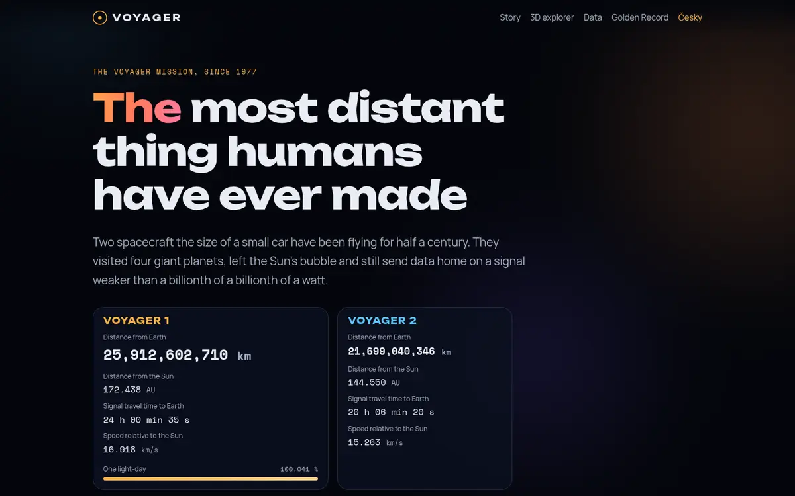
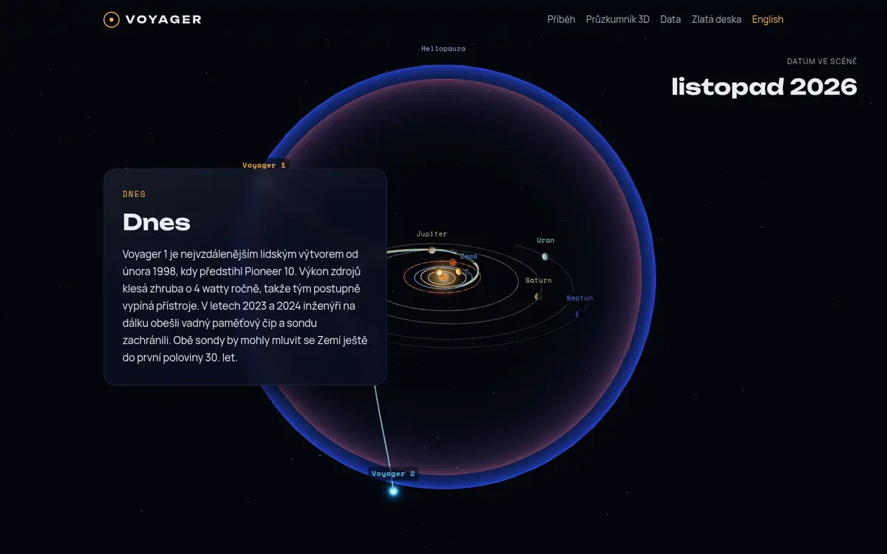
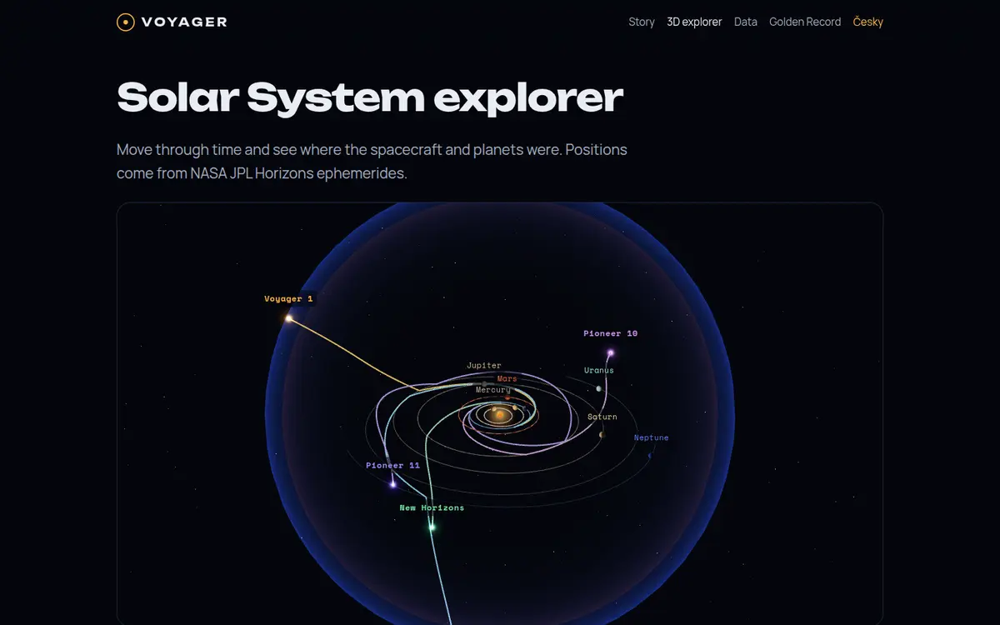
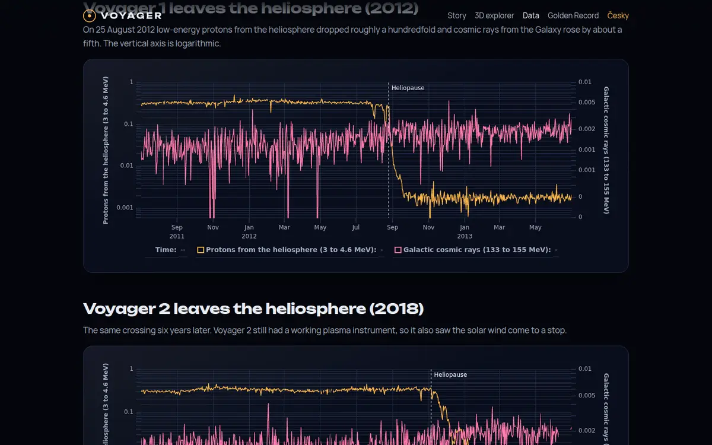

<div align="center">

# Voyager

**An interactive 3D story of the two most distant spacecraft humans have ever built.**

[voyager.vazac.dev](https://voyager.vazac.dev) | [English](https://voyager.vazac.dev/en/) | [3D explorer](https://voyager.vazac.dev/en/explore/) | [Data lab](https://voyager.vazac.dev/en/data/)



</div>

Voyager 1 and 2 launched in 1977, visited Jupiter, Saturn, Uranus and Neptune, and are now in interstellar space. This site tells that story with real data. Every trajectory, distance and particle count on the page comes from NASA, not from an illustration.

## What is inside

|                                               |                                                                                                                                                                          |
| --------------------------------------------- | ------------------------------------------------------------------------------------------------------------------------------------------------------------------------ |
| **Live counters**                             | Distance from Earth and the Sun, signal travel time and speed, ticking in real time. Voyager 1 crossed one light-day from Earth in November 2026, and the page shows it. |
| **Scroll-driven journey**                     | Scroll and time moves with you, from launch through every flyby, the Pale Blue Dot and both heliopause crossings, to today. The camera follows real JPL trajectories.    |
| **3D Solar System explorer**                  | Scrub from 1972 to 2031, follow any body, compare Voyager with Pioneer 10/11 and New Horizons, and switch between log and true scale.                                    |
| **Data lab**                                  | Interactive charts of real daily measurements: the 2012 and 2018 heliopause crossings, distance, magnetic field and solar wind.                                          |
| **Live Deep Space Network**                   | Shows which DSN dish is talking to the Voyagers right now.                                                                                                               |
| **Spacecraft, power, Golden Record, gallery** | NASA's 3D model, instrument status, the power budget, an explorable record cover and a 1990 vs 2020 Pale Blue Dot slider.                                                |

Czech is the primary language, with English under `/en/`.

<table>
  <tr>
    <td></td>
    <td></td>
  </tr>
  <tr>
    <td colspan="2"></td>
  </tr>
</table>

## How the data works

`pnpm data` runs `scripts/fetch-data.mjs` at build time and writes static JSON to `public/data/`. Nothing on the page calls NASA at runtime except the DSN proxy.

| File             | Source                                                            | Contents                                                                                                                                                                                       |
| ---------------- | ----------------------------------------------------------------- | ---------------------------------------------------------------------------------------------------------------------------------------------------------------------------------------------- |
| `ephemeris.json` | [JPL Horizons](https://ssd.jpl.nasa.gov/horizons/)                | Heliocentric ecliptic positions (AU) for the Voyagers, Pioneers, New Horizons and the eight planets. Fetched at 1-day steps, then decimated to a fixed error tolerance (about 120 KB gzipped). |
| `live.json`      | JPL Horizons                                                      | Daily range from Earth and the Sun plus speed for the next ~450 days. The client interpolates it for the live counters.                                                                        |
| `science.json`   | [NASA SPDF COHOWeb](https://spdf.gsfc.nasa.gov/pub/data/voyager/) | Merged daily magnetometer, plasma and cosmic ray data for both craft. Includes 5-day bins for the whole mission and daily data around each heliopause crossing.                                |

`/api/dsn.xml` is an nginx reverse proxy to [NASA DSN Now](https://eyes.nasa.gov/dsn/), cached for 30 seconds. See `deploy/voyager.vazac.dev.nginx.conf`.

`live.json` only covers about 15 months ahead, so the site needs a rebuild at least once a year.

## Stack

- [Astro](https://astro.build) static output, with a hashed Content Security Policy per page
- [React Three Fiber](https://r3f.docs.pmnd.rs) and drei for the 3D scenes. Each one is a lazy island that pauses when off screen.
- [uPlot](https://github.com/leeoniya/uPlot) for charts, [Lenis](https://lenis.darkroom.engineering) for smooth scrolling
- Unbounded, Manrope and Space Mono, self-hosted through Fontsource
- Respects `prefers-reduced-motion` (no smooth scroll, no auto-animation) and falls back to text when WebGL is missing

## Development

Requires Node 24 and pnpm.

```bash
pnpm install
pnpm data      # refresh NASA data into public/data/
pnpm dev       # http://localhost:4321
pnpm check     # astro check + eslint + prettier
pnpm build     # static site in dist/
```

Deploying is rsync over SSH to any static host with the nginx config in `deploy/`:

```bash
DEPLOY_TARGET=user@host DEPLOY_SSH_KEY=~/.ssh/key pnpm release   # data + build + deploy + URL checks
```

Optional environment variables, all off when unset (see `.env.example`): cookieless Umami analytics and a Sentry DSN. The site sets no cookies.

## Credits and licenses

The source code is [MIT](LICENSE). Third-party media and data keep their own terms:

- **Trajectories and measurements:** NASA JPL Horizons and NASA SPDF. Public data.
- **Voyager 3D model and mission images:** NASA/JPL-Caltech. NASA media is generally not subject to copyright in the United States. Per-image credits and source links are in [`src/data/images.json`](src/data/images.json).
- **Planet and Sun textures:** [Solar System Scope](https://www.solarsystemscope.com/textures/), licensed [CC BY 4.0](https://creativecommons.org/licenses/by/4.0/).
- **Fonts:** Unbounded, Manrope and Space Mono, under the SIL Open Font License.
- **Golden Record music** is not included, since much of it is still under copyright.

This is an independent fan project. It is not affiliated with or endorsed by NASA or JPL.
